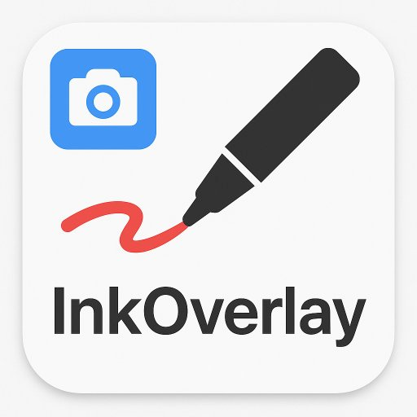

# InkOverlay — Рисуй и Создавай Скриншоты



**InkOverlay** — интуитивное расширение для браузера, которое превращает любую веб-страницу в интерактивный холст для рисования и создания скриншотов.

## 🎨 Возможности

### Инструменты для рисования
- ✏️ **Карандаш** - свободное рисование
- ➡️ **Стрелки** - указатели для выделения
- 📏 **Линия** - прямые линии
- 📝 **Текст** - текстовые заметки
- ⬜ **Прямоугольник** - геометрические фигуры
- ⭕ **Круг** - круглые выделения
- 🧹 **Ластик** - удаление элементов
- 🎨 **Настройки** - цвет и толщина линии

### Управление
- ↩️ **Отмена/Повтор** - отмена и повтор действий
- 🗑️ **Очистить всё** - удаление всех рисунков
- 🌙 **Темная тема** - переключение темы интерфейса
- ⌨️ **Горячая клавиша** - ESC для выхода

### Скриншоты
- 📸 **Скриншот видимой части** - захват текущего окна браузера
- 💾 **Автосохранение** - скриншоты сохраняются в папку загрузок
- 📋 **Буфер обмена** - автоматическое копирование в буфер
- 📚 **История** - просмотр всех сохраненных скриншотов

### Автосохранение
- 💾 **Автосохранение аннотаций** - рисунки сохраняются автоматически
- 🔄 **Привязка к странице** - аннотации остаются на конкретных страницах
- 📍 **Восстановление** - рисунки загружаются при повторном посещении

## 🚀 Установка

### Для разработчиков (загрузка в режиме разработки)

1. **Скачайте или клонируйте репозиторий**
   ```bash
   git clone https://github.com/QuestGuideRF/inkoverlay.git
   cd inkoverlay
   ```

2. **Загрузите расширение в Chrome/Edge**
   - Откройте `chrome://extensions/` (или `edge://extensions/`)
   - Нажмите "Загрузить распакованное расширение"
   - Выберите папку InkOverlay

3. **Готово!** Расширение установлено и готово к использованию

## 📖 Как использовать

### Активация режима рисования
1. Нажмите на плавающую кнопку ✏️ в правом верхнем углу любой страницы
2. Появится панель инструментов

### Рисование и аннотации
1. Выберите инструмент на панели (карандаш, стрелка, текст, фигура)
2. Настройте цвет и толщину линии
3. Рисуйте прямо на странице
4. Ваши аннотации автоматически сохраняются

### Создание скриншотов
1. Нажмите на иконку 📸 на панели инструментов
2. Скриншот видимой части автоматически:
   - Сохранится в папку загрузок
   - Скопируется в буфер обмена
   - Добавится в историю

### Просмотр истории
1. Нажмите на иконку расширения в панели браузера
2. Откроется popup с историей всех скриншотов
3. Нажмите на скриншот для просмотра или скачивания

## ⚙️ Настройки

Откройте popup расширения:

### Настройки рисования
- Цвет по умолчанию
- Толщина линии
- Размер текста
- Автосохранение аннотаций

## 🛠️ Технологии

- **Manifest V3** - современная версия расширений Chrome
- **Canvas API** - для рисования поверх веб-страниц
- **Chrome Storage API** - сохранение данных
- **Chrome Downloads API** - скачивание скриншотов
- **Clipboard API** - копирование в буфер обмена
- **Vanilla JavaScript** - без зависимостей

## 📁 Структура проекта

```
InkOverlay/
├── 📄 manifest.json              # Манифест расширения (Manifest V3)
├── 📁 background/                # Background Service Worker
│   └── background.js              # Обработка скриншотов, контекстное меню
├── 📁 content/                   # Content Scripts
│   ├── content.js                 # Главный скрипт с Canvas overlay
│   └── content.css                # Стили для панели инструментов
├── 📁 popup/                     # Popup интерфейс
│   ├── popup.html                 # HTML структура popup
│   ├── popup.css                  # Стили popup
│   └── popup.js                   # Логика popup (история, настройки)
├── 📁 icons/                     # Иконки расширения
└── 📄 README.md                  # Этот файл
```

## 💾 Хранение данных

### Chrome Storage (Local)

**savedDrawings** (объект) - аннотации по URL
```javascript
{
  "https://example.com": {
    url: "https://example.com",
    drawings: [...],      // Массив объектов рисунков
    timestamp: 1234567890
  }
}
```

**screenshotHistory** (массив, до 100 элементов)
```javascript
[
  {
    id: 1234567890,
    dataUrl: "data:image/png;base64,...",
    filename: "InkOverlay_example.com_2025-10-29.png",
    pageUrl: "https://example.com",
    pageTitle: "Example Page",
    timestamp: 1234567890,
    domain: "example.com"
  }
]
```

## 🔧 Технологии и API

### Chrome Extension APIs
- `chrome.runtime` - Коммуникация между компонентами
- `chrome.storage` - Хранение данных
- `chrome.tabs` - Работа с вкладками
- `chrome.downloads` - Скачивание файлов
- `chrome.contextMenus` - Контекстное меню
- `chrome.clipboard` - Копирование в буфер обмена

### Web APIs
- `Canvas API` - Рисование
- `DOM API` - Манипуляция страницей
- `FileReader API` - Чтение файлов
- `Blob API` - Работа с данными

---

Автор: legenda  
Telegram: [@LEGENDA_SD](https://t.me/LEGENDA_SD)
